# Everyday

**A calm, private self-development web app.** A few minutes a day: a small lesson, a mood check-in, gentle habits and a short journal. It is meant to feel like a quiet morning: warm, encouraging, never judgmental.

**Live app:** https://everyday-quiet-mornings.netlify.app

<p>
  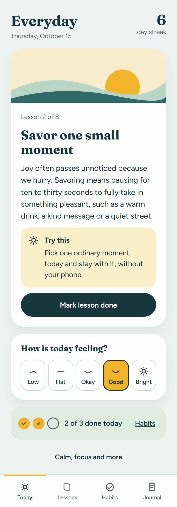
  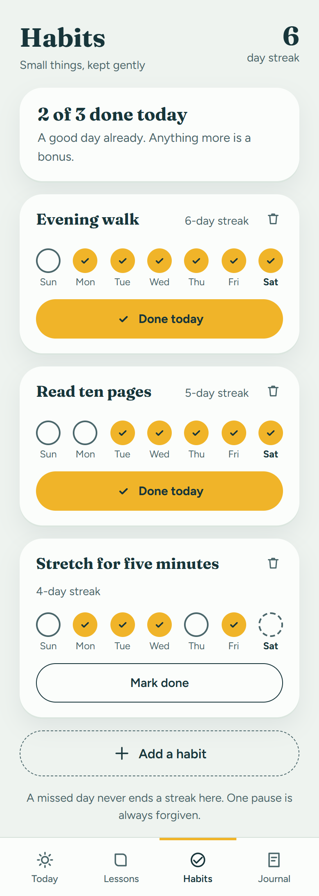
  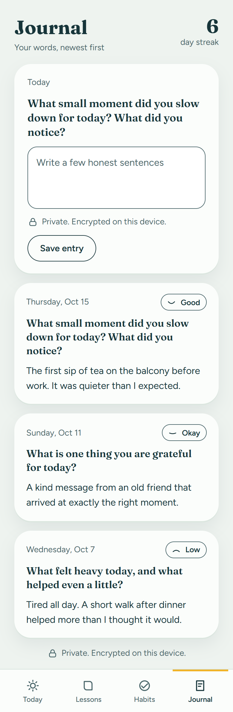
</p>

- **Small daily lessons.** 96 lessons, 8 for each month, each month with its own theme. Optional, in any order, never expiring.
- **Gentle habits.** One tap to mark a habit done, a week at a glance, and a streak that forgives one missed day.
- **A short journal.** Each day's prompt matches that day's lesson. Every entry keeps the mood of the day.
- **End-to-end encrypted.** Everything is encrypted on your device with your passphrase before it is saved. The server only ever stores ciphertext.
- **Works offline, installs like an app.** It is a Progressive Web App with reminders by Web Push, even when it is closed.
- **Never shames.** No red, no "failed" or "missed" states, no guilt copy. Accessible, in light and dark themes.

---

## Contents

1. [Pages](#pages)
2. [Tech stack](#tech-stack)
3. [How it works](#how-it-works)
4. [Privacy and security](#privacy-and-security)
5. [Design principles](#design-principles)
6. [Project structure](#project-structure)
7. [Run it locally](#run-it-locally)
8. [Set up Supabase](#set-up-supabase)
9. [Deploy](#deploy)
10. [Testing](#testing)

---

## Pages

The layout adapts to the screen: a **bottom tab bar** on phones, a **narrow icon rail** on tablets (768px and wider) and a **sidebar** on desktop (1100px and wider). The components are the same at every size; the grids reflow.

### Sign in and passphrase

<p>
  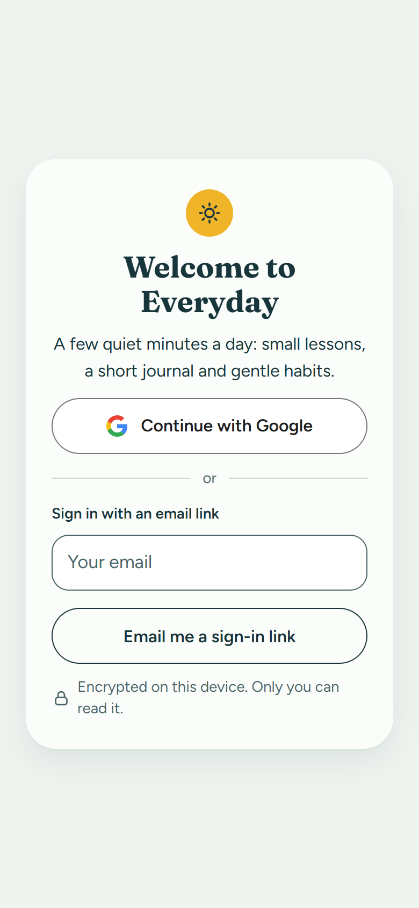
  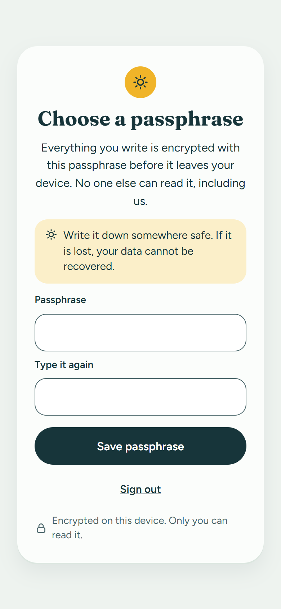
</p>

- **Sign in with Google** in one tap, or with an **email link** as a backup. There is no password to remember either way. Email links are sent through Gmail, not Supabase's rate-limited test service (see [docs/sign-in-setup.md](docs/sign-in-setup.md)).
- **The first time,** you choose a **passphrase**. It is the key to your encrypted data, and it never leaves your device. The screen says plainly that a lost passphrase cannot be recovered.
- **On a new device,** you sign in and enter the same passphrase, and your data arrives from the cloud.
- **PIN lock (optional):** with it on, the app asks for a PIN when it opens. The data on the device stays encrypted until you enter it. A forgotten PIN can be replaced by entering your passphrase.

### Today

<p>
  
  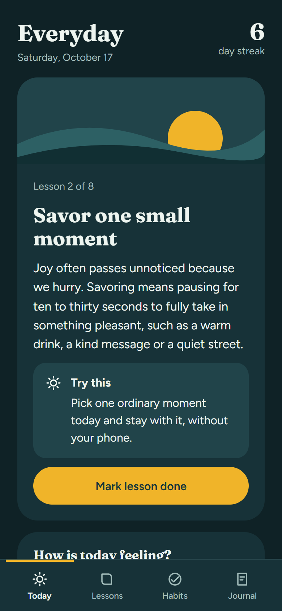
</p>

One clear action per screen. Today shows:

- **Today's lesson:** a sunrise illustration, "Lesson n of 8", the title, a short read, a **Try this** suggestion and **Mark lesson done**. A lesson finished today stays here until tomorrow. Otherwise Today shows the first open lesson of the month.
- **How is today feeling?:** five moods (Low, Flat, Okay, Good, Bright). Each one is an icon plus a word, never a colour alone. Tap the chosen mood again to clear it.
- **Habit summary:** "2 of 3 done today", with a dot for each habit and a link to Habits. It is hidden when there are no habits.
- **The day streak** in the corner: days with any activity. One missed day inside a run is forgiven.

The journal box is deliberately not on Today. It lives on the Journal tab.

### Lessons

<p>
  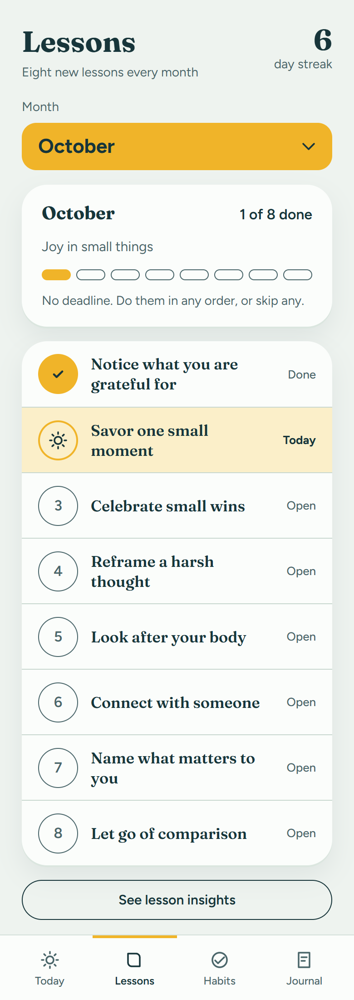
  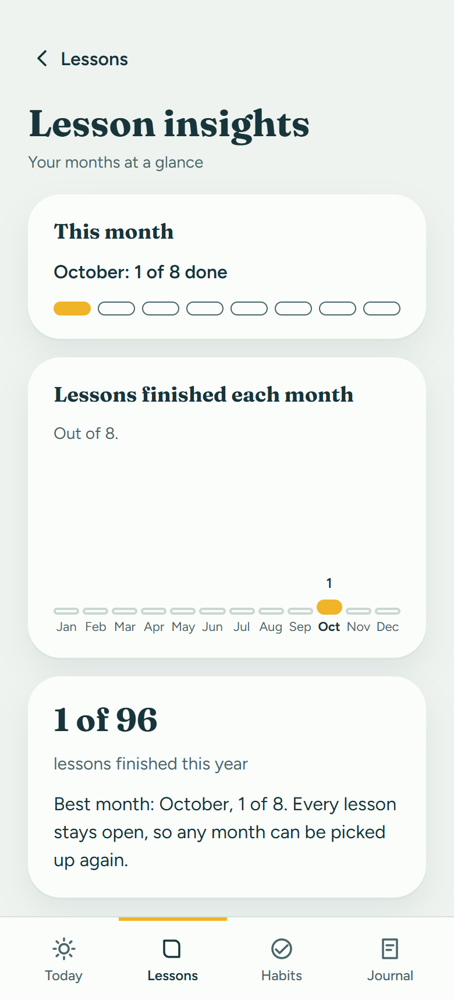
</p>

- **Month picker:** a dropdown on phones and tablets, chips on desktop. It defaults to the current month.
- **Month card:** the month's theme (for example October, "Joy in small things"), "1 of 8 done" with eight segments, and "No deadline. Do them in any order, or skip any."
- **The month's eight lessons,** each marked **Done**, **Today** or **Open**, with a shape as well as the word. Open any lesson to read it or do it again.
- **Lesson insights:** this month's progress, a bar chart of lessons finished each month (out of 8), the year total (n of 96) and the best month. It shows patterns, not verdicts. Screen readers get the same numbers as a list.

All 96 lessons live in [`data/lessons.seed.json`](data/lessons.seed.json). Content can be edited there without touching the code.

### Habits

<p>
  
  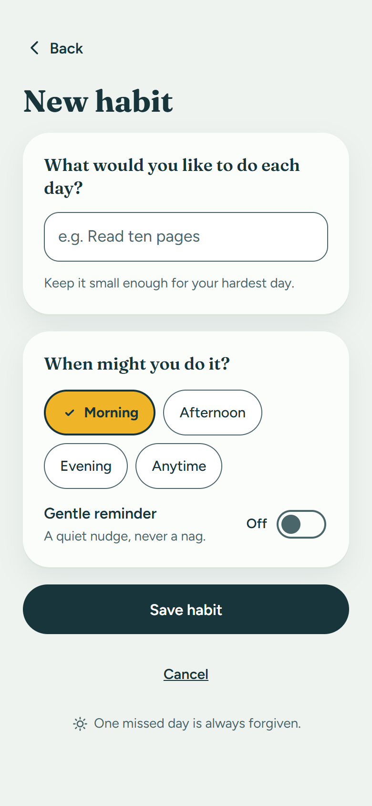
  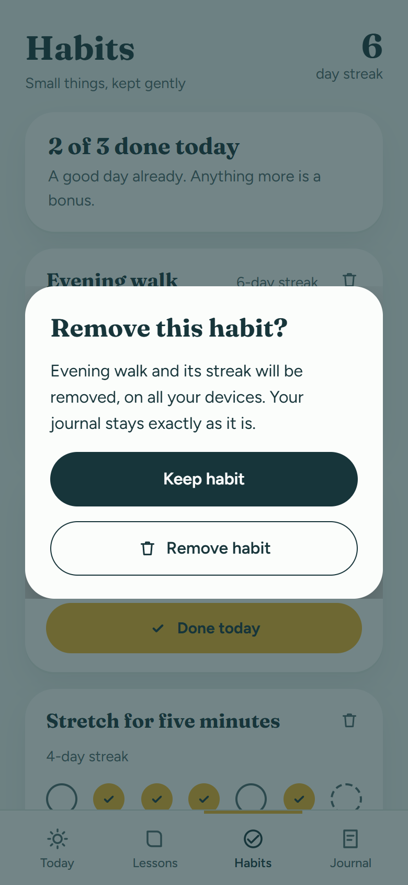
</p>

- **Each habit** has its streak, a **Sunday to Saturday week row** and one button: **Done today** or **Mark done**.
  - **Done:** filled in, with a check.
  - **A past day not done:** a quiet outline, never red.
  - **Today, not done yet:** a dashed circle.
  - **Future days:** faint.
- **Streaks forgive one missed day.** "A missed day never ends a streak here. One pause is always forgiven."
- **New habit:** a name, a time of day (morning, afternoon, evening or anytime) and an optional **gentle reminder**. An empty Habits page offers ideas to start from.
- **Removing a habit** asks first, and **Keep habit** is the main button. There is no red.
- **Motion:** marking a habit done draws the check in (240ms) and the day's dot grows slightly and settles. With reduced motion on, the state simply changes.

### Journal

<p>
  
</p>

- **The Today card** shows the prompt that matches today's lesson, a writing box and **Save entry**.
- **Past entries** are listed newest first, each with its date, a mood chip (icon and word), the prompt and your words.
- **Wider screens** add a **This month** card that counts how your entries felt.
- **Drafts** are kept in memory only, never written to disk unencrypted.

### Calm corner, Focus, Weekly review, Mood insights

<p>
  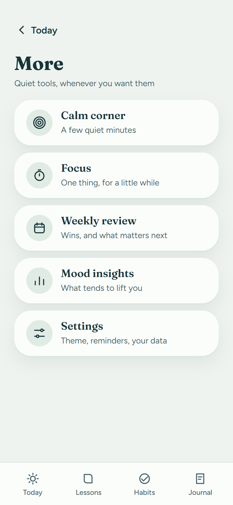
  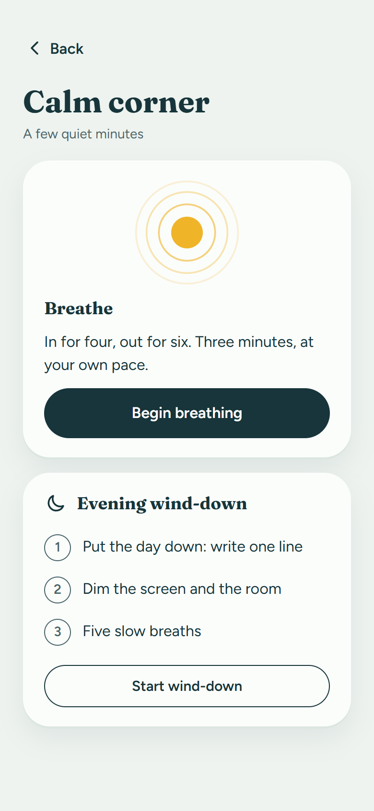
  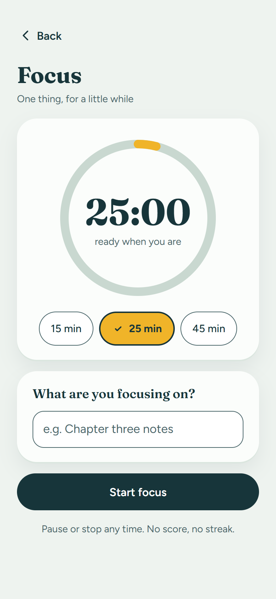
</p>
<p>
  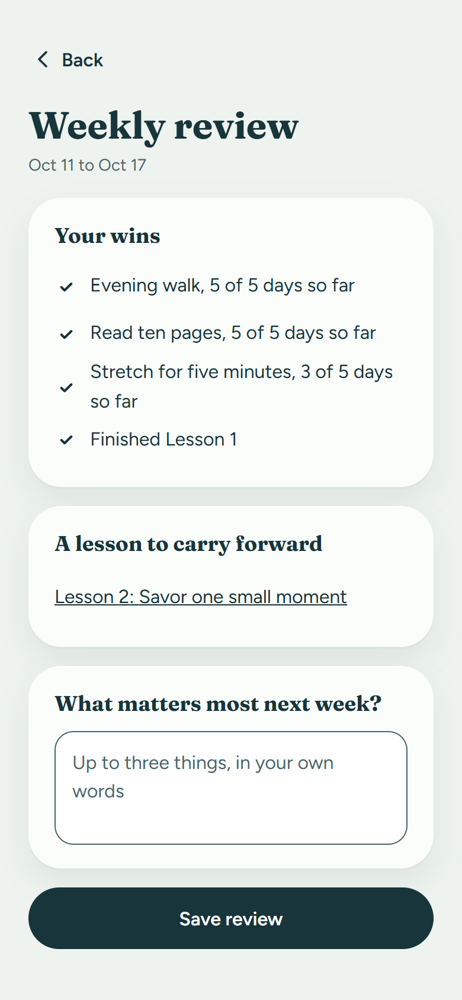
  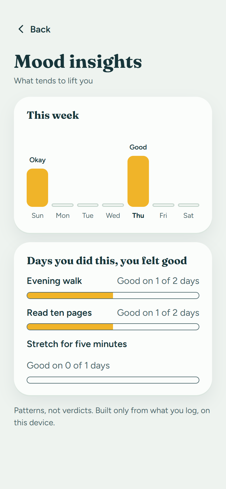
</p>

These quieter tools sit in the desktop sidebar, behind **More** on the tablet rail, and behind a "Calm, focus and more" link on Today on phones.

- **Calm corner:**
  - **Breathing:** in for four, out for six, for three minutes. A circle grows and shrinks with the breath; with reduced motion it stays still and the words lead.
  - **Evening wind-down:** three steps: write one line (saved to your journal), dim the screen, take five slow breaths.
- **Focus:** a 15, 25 or 45 minute timer with an optional "what are you focusing on". You can pause or stop any time; there is no score and no streak. It survives a reload.
- **Weekly review:** your wins this week (only wins), a lesson to carry forward, and "What matters most next week?", saved for each week.
- **Mood insights:** this week's moods as bars labelled with the mood, and "Days you did this, you felt good" for each habit over the last 30 days. Patterns, not verdicts.

### Settings

<p>
  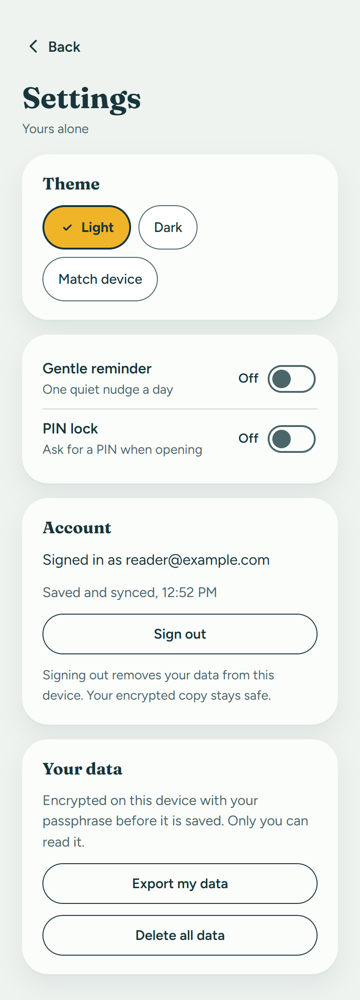
</p>

- **Theme:** Light, Dark or Match device (the default).
- **Gentle reminder:** one quiet nudge a day by Web Push, even when the app is closed.
- **PIN lock:** a PIN unlocks the encrypted data on this device.
- **Account:** your email, the sync status, and Sign out (which removes the data from this device; the encrypted cloud copy stays).
- **Your data:** export everything as a readable JSON file, or delete everything, both the cloud copy and the account. Deleting asks first, and "Keep my data" is the main button.

### Tablet and desktop

<p>
  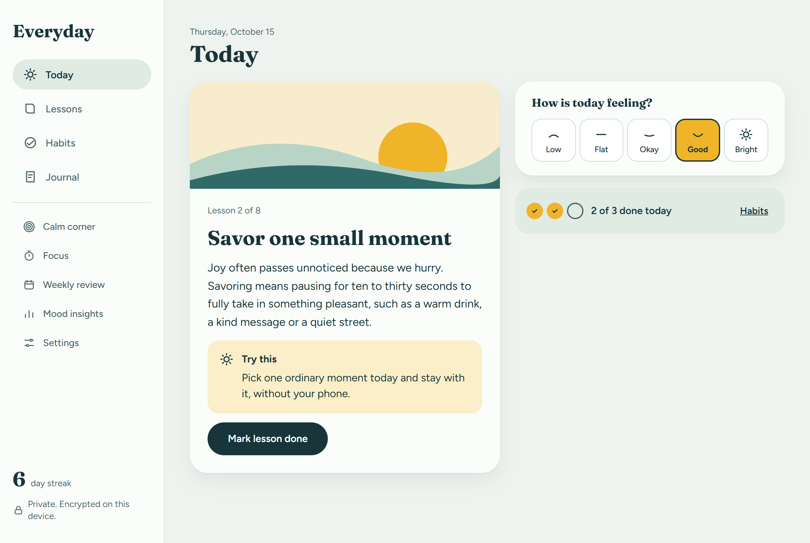
</p>
<p>
  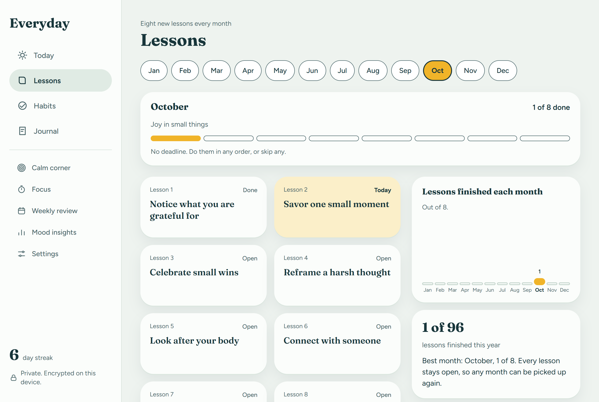
</p>
<p>
  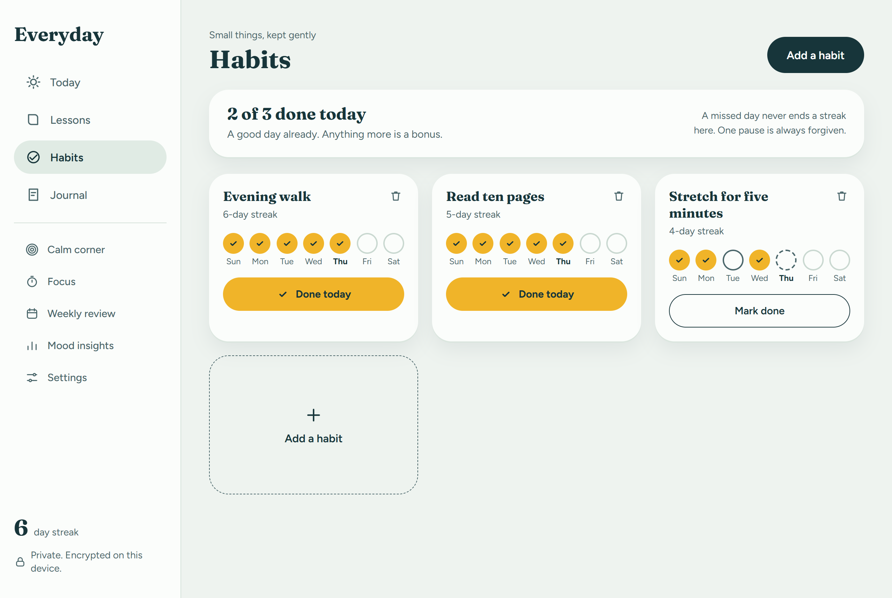
  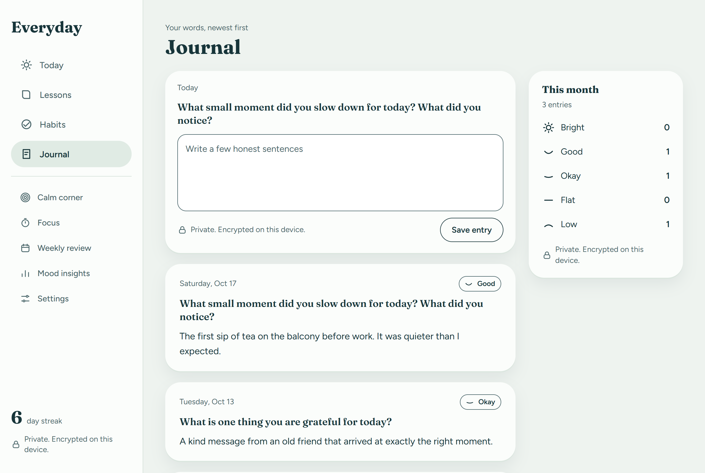
</p>
<p>
  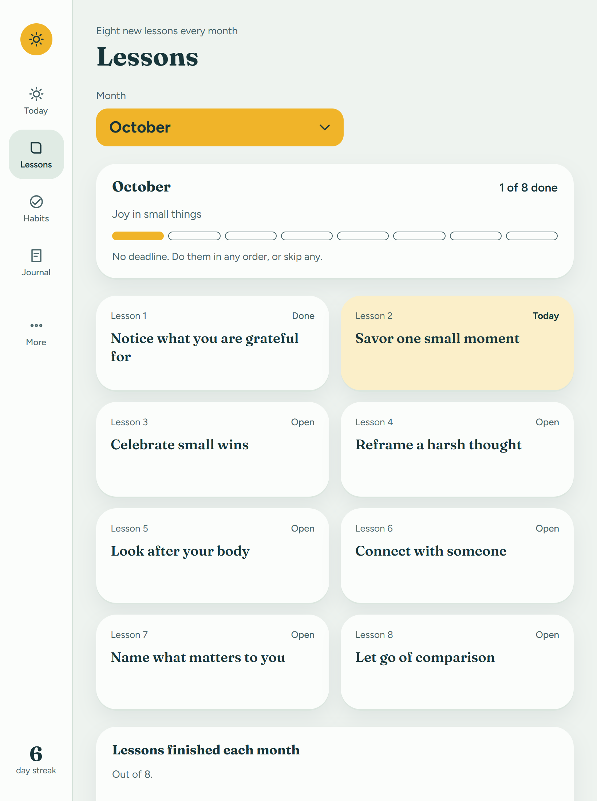
  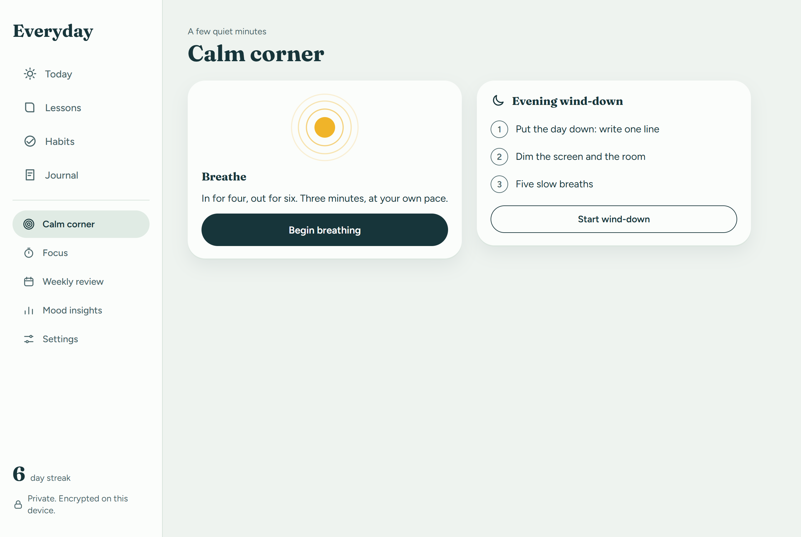
</p>

---

## Tech stack

| Layer | Technology | Why |
|---|---|---|
| UI | **React 18** + **TypeScript 5** | Small, typed components. No UI framework: every screen follows the design boards exactly. |
| Build | **Vite 5** | Fast development server and an optimised production build. |
| Styling | **Plain CSS with design tokens** (`src/styles/tokens.css`) | Colours, type, spacing and radii come straight from the design system. Light and dark themes are a token swap. |
| Fonts | **Fraunces** (headings) and **Figtree** (body), self-hosted via **Fontsource** | No requests to Google Fonts, and they work offline. |
| Routing | A ~60-line **hash router** (`src/router.ts`) | No dependency, and it works on any static host and offline. |
| App state | An in-memory **store** with `useSyncExternalStore` (`src/data/store.ts`) | Screens read decrypted data synchronously and update live. |
| Local storage | **Dexie** (IndexedDB) | The encrypted local copy that keeps the app working offline. |
| Encryption | The **Web Crypto API**: PBKDF2-SHA-256, AES-GCM, HKDF, HMAC | End-to-end encryption with the browser's own audited cryptography, and no crypto libraries. |
| Backend | **Supabase**: Auth (Google sign-in and email links sent through Gmail SMTP), Postgres with row level security, Edge Functions (Deno), `pg_cron` + `pg_net`, Vault | Sign-in, encrypted storage, scheduled reminders and account deletion. |
| Offline and install | **vite-plugin-pwa** + **Workbox**, with a custom service worker (`src/sw/sw.ts`) | Precaches the app so it opens offline, and receives push reminders. |
| Reminders | **Web Push** with VAPID keys, sent by the `web-push` library in an Edge Function | Nudges arrive even when the app is closed. |
| Hosting | **Netlify** | Static hosting over HTTPS, with security headers set in `netlify.toml`. |
| Tests | **Node's built-in test runner** | Tests for the streak logic and the encryption, with no test framework to install. |

---

## How it works

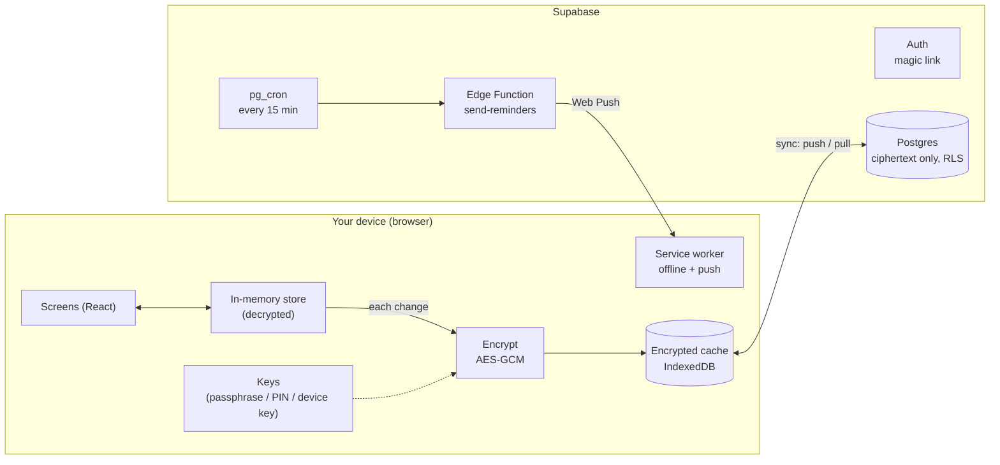

1. **Screens read from an in-memory store** of decrypted data, so they are instant and work offline.
2. **Every change** (a mood, a habit done, a journal entry) is encrypted on the device and saved to the **encrypted local cache**, then sent to Supabase when you are online.
3. **Sync** pulls changes from your other devices. If the same thing was changed in two places, **the latest change wins**. A database trigger makes sure an older change arriving late can't overwrite a newer one.
4. **Reminders:** a scheduled job runs every 15 minutes. If a reminder is due and today is not done yet, it sends a Web Push to your devices. The service worker shows it, decrypting the habit's name on your device.

### The streak rule

One place in the code holds it: [`everyday/src/data/streak.ts`](everyday/src/data/streak.ts).

- A streak counts active days, walking back from today.
- **One missed day between two active days is forgiven.** It doesn't break the run, and it doesn't add to the count.
- Two missed days in a row end the run.
- Today never counts as missed, because the day isn't over yet.

---

## Privacy and security

- **End-to-end encryption.**
  - Each account has a random 32-byte **master secret**. It is stored in the cloud only *wrapped* by your passphrase (PBKDF2-SHA-256 with 600,000 rounds, then AES-GCM).
  - From that secret, HKDF derives an AES-GCM key for records and an HMAC key for record IDs.
  - Every record is encrypted before it leaves the device. Its ID is an HMAC, so the server sees no dates, names or text.
- **What the server can see:** ciphertext, opaque IDs, when each record last changed, and for reminders an hour, a time zone and whether today is done (needed to send nudges on time). Habit names in reminders travel encrypted.
- **On the device,** the master secret is wrapped by a browser key that cannot be exported, or, with **PIN lock**, by your PIN, so the data stays encrypted until you unlock.
- **Row level security:** every table only ever returns the signed-in person's own rows. A signed-out visitor gets nothing.
- **Strict Content Security Policy:** the live site only loads its own files and only talks to its own Supabase project. Also: no referrer, no camera or microphone access, and HTTPS only.
- **No analytics** and no third-party scripts.

Honest limits:
- **A forgotten passphrase cannot be recovered**, by anyone. That is the price of end-to-end encryption. The app offers to start over.
- **Short PINs:** a 4-digit PIN slows down, but does not stop, someone who already has your unlocked device's storage. Use 6 digits or more.
- **iPhone:** push reminders on iPhone need the app added to the Home Screen first (iOS 16.4 or later).
- **Sign-in links** must be opened in the same browser that asked for them.

---

## Design principles

- **Never shame.** No red, no "failed" or "missed" states, no guilt copy. Unfinished lessons say "Open". A missed habit day is a quiet outline.
- **One clear action per screen.** Anything not needed today stays out of the way.
- **Accessible:**
  - WCAG AA contrast, checked for every text colour in both themes.
  - Tap targets of at least 44px.
  - A visible two-tone focus ring.
  - Native dialogs that trap focus and close with Escape.
  - Focus moves to the page heading after navigation.
  - Screen-reader text for charts.
- **State is never shown by colour alone.** A mood is an icon and a word; progress is text and a shape.
- **Motion respects `prefers-reduced-motion`.** Pages fade in over 180ms with a 6px rise, and the habit check draws in. With reduced motion, nothing moves.
- **Light and dark themes** follow the device by default and can be changed in Settings.

The original brief is in [`CLAUDE.md`](CLAUDE.md), and the design boards are in [`design/`](design/).

---

## Project structure

```
everyday-handoff/
├── CLAUDE.md                 Product brief and principles
├── data/lessons.seed.json    All 96 lessons (12 months × 8), the only source of lesson content
├── design/                   Design boards (.dc.html) and tokens.css
├── docs/screenshots/         Images used in this README
└── everyday/                 The web app
    ├── index.html
    ├── netlify.toml          Hosting: security headers and caching
    ├── public/               Icons, favicon, theme-init.js
    ├── supabase/
    │   ├── migrations/       Database tables, row level security, reminder schedule
    │   ├── functions/        Edge Functions: send-reminders, delete-account
    │   └── cron.sql          The one manual step (store the cron secret in Vault)
    └── src/
        ├── App.tsx           Chooses sign-in, passphrase, PIN or the app
        ├── router.ts         Hash router
        ├── data/             Store, encryption, keys, sync, session, lessons, streak logic
        ├── screens/          One folder per screen (today, lessons, habits, journal, ...)
        ├── shell/            Tab bar (phone), rail (tablet), sidebar (desktop)
        ├── sw/sw.ts          Service worker: offline cache and push reminders
        ├── styles/           tokens.css, base, shell, ui and screen styles
        └── ui/               Shared components: Card, Icon, Dialog, Switch, ...
```

---

## Run it locally

You need **Node.js 22**.

```bash
cd everyday
npm install
cp .env.example .env.local   # then fill in your Supabase URL and publishable key
npm run dev                  # http://localhost:5173
```

To try everything **without a Supabase project**, run:

```bash
npm run dev:fake
```

That uses a built-in **fake cloud** stored in the browser. The "magic link" signs in at once. Add `?demo` to the address to load sample data. The fake cloud and the demo data are development-only and never part of a production build.

| Script | What it does |
|---|---|
| `npm run dev` | Development server against your Supabase project |
| `npm run dev:fake` | Development server against the fake cloud |
| `npm test` | Streak and encryption tests |
| `npm run build` | Type-check, then a production build in `dist/`, including the service worker |
| `npm run preview` | Serve the production build locally |
| `npm run deploy` | Build and publish to Netlify |

**Environment variables** (in `everyday/.env.local`; all are public by design):

| Variable | Meaning |
|---|---|
| `VITE_SUPABASE_URL` | Your Supabase project URL |
| `VITE_SUPABASE_PUBLISHABLE_KEY` | The project's publishable key. Leave it empty to use the fake cloud. |
| `VITE_VAPID_PUBLIC_KEY` | The public half of the Web Push key pair |
| `VITE_GOOGLE_SIGN_IN` | Set to `on` once Google is enabled in Supabase, to show "Continue with Google" |

---

## Set up Supabase

1. **Database:** apply the SQL files in `everyday/supabase/migrations/` in order.
2. **Edge Functions:** deploy `send-reminders` with **JWT verification off** (it checks its own secret) and `delete-account` with **JWT verification on**.
3. **Function secrets** (Dashboard → Edge Functions → Secrets): `VAPID_PUBLIC_KEY`, `VAPID_PRIVATE_KEY`, `VAPID_SUBJECT` (`mailto:` followed by your email) and `CRON_SECRET`. Generate the VAPID pair with `npx web-push generate-vapid-keys`.
4. **Cron secret:** run the line in `everyday/supabase/cron.sql` in the SQL editor, with your `CRON_SECRET` pasted in.
5. **Auth URLs** (Authentication → URL Configuration): set the Site URL to your live address, and add it and `http://localhost:5173` as redirect URLs.
6. **Sign-in:** connect Gmail as the email sender and turn on Google sign-in. Step by step: [docs/sign-in-setup.md](docs/sign-in-setup.md).

Secrets live only in Supabase and in a git-ignored `everyday/supabase/.env.secrets`. They are never committed.

---

## Deploy

The app is a static site, so any static host works. This project uses Netlify:

```bash
cd everyday
npx netlify-cli login        # once
npm run deploy
```

`netlify.toml` sets the Content Security Policy and other security headers, plus caching:
- **Page, manifest and service worker:** always re-checked, so updates arrive.
- **Fingerprinted assets:** cached for a year.

When you add a custom domain, also add it to Supabase **Authentication → URL Configuration**.

---

## Testing

```bash
cd everyday
npm test              # unit tests
npm run dev:fake      # in one terminal
npm run test:e2e      # in another: every feature, in a real headless browser
```

**Unit tests** (19 in total):
- The streak rule: forgiven days, two missed days, month and year boundaries, daylight-saving changes.
- The encryption: a wrong passphrase fails, ciphertext hides the text, accounts can't read each other's records, and record IDs are stable.

**End-to-end test** (`e2e/run.mjs`, 22 checks). It drives headless Edge or Chrome through every feature against the fake cloud, with no test framework to install. Any error from the app's code fails the run.
- Sign-in with Google and email, including the email checks; choosing a passphrase, including its checks.
- Today: the lesson card, mark done and undo, the streak, and the mood check-in.
- Lessons: statuses, the month picker, lesson detail and insights.
- Habits: empty state, idea chips, adding, done and undo, streaks, and the remove dialog. The habit summary on Today.
- Journal (including the mood carried by each entry), weekly review, mood insights, the focus timer, breathing and the wind-down.
- Settings: theme and export.
- Data surviving a reload.
- PIN lock: a wrong PIN, the right PIN, and a forgotten PIN.
- A new device restoring everything with the passphrase.
- Sign out and back in.
- At phone, tablet and desktop size: the right navigation, no sideways scrolling, and 44px tap targets.
- Deleting everything.

**Checked by hand:** keyboard navigation and focus, reduced motion, offline use, the security headers on the live site, and the server's security rules from outside (signed-out visitors can read and write nothing).
